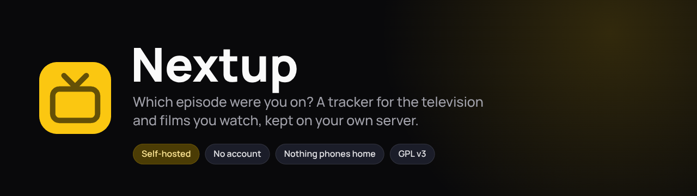
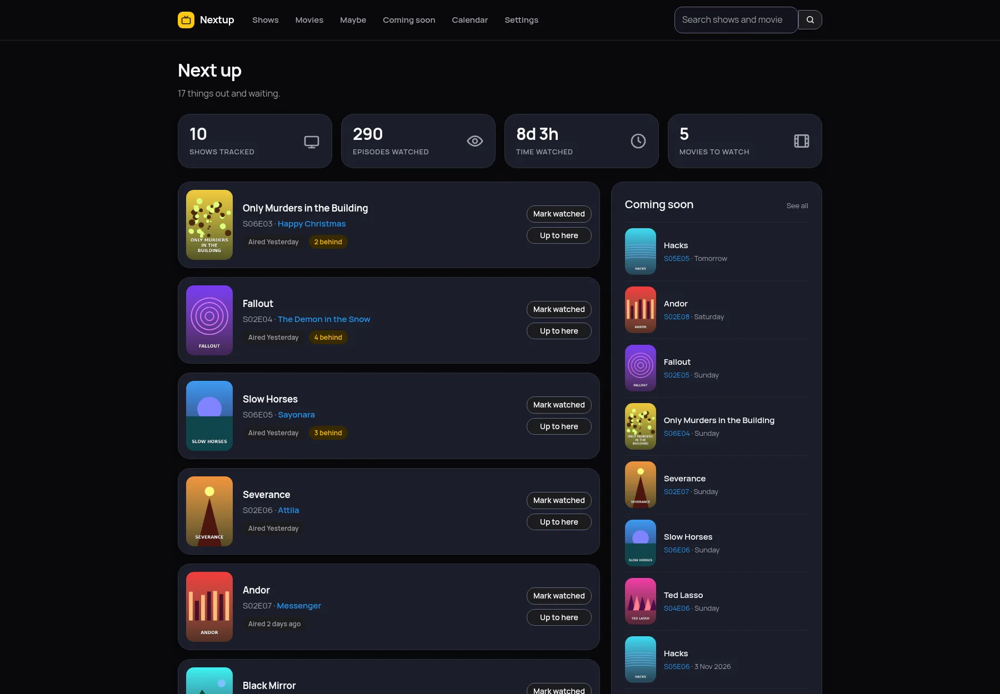
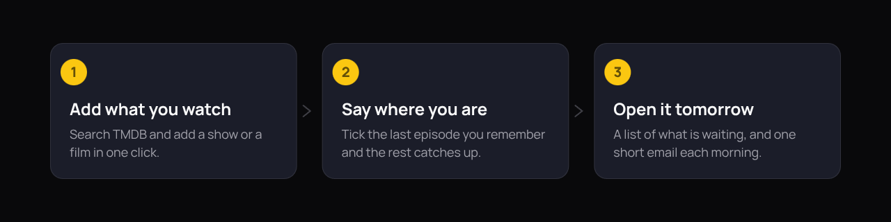
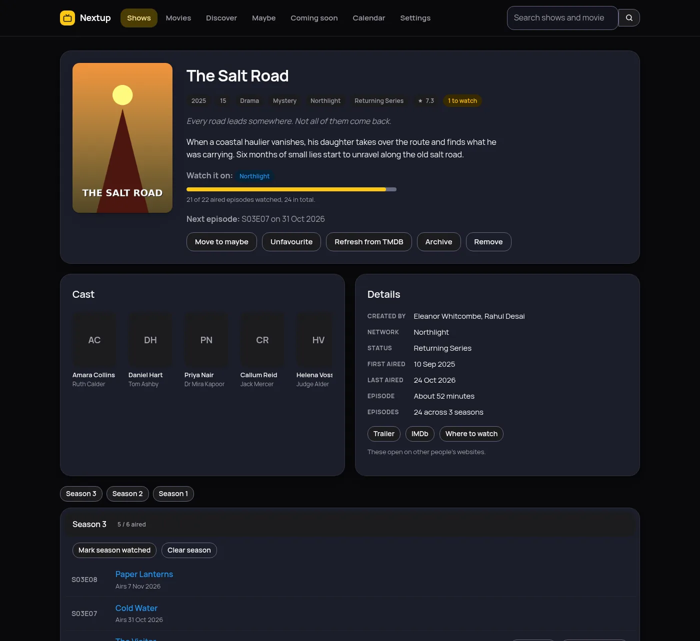
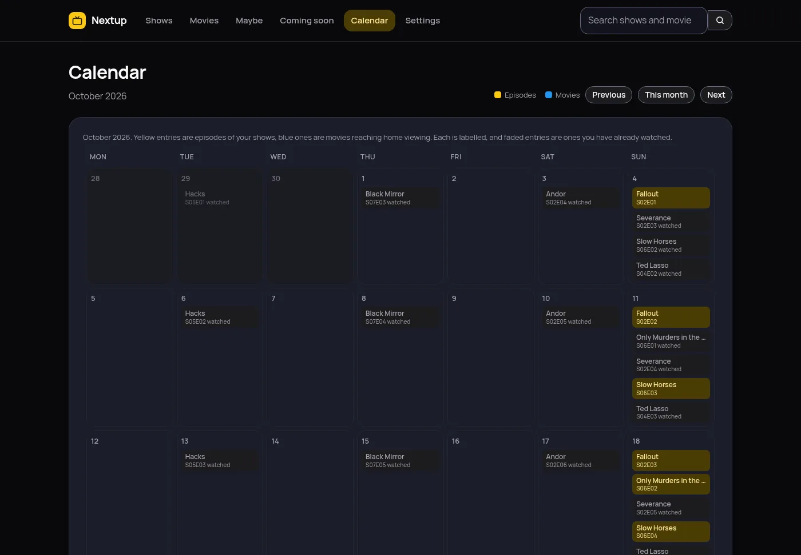
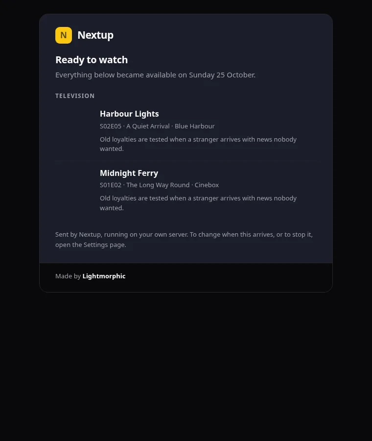
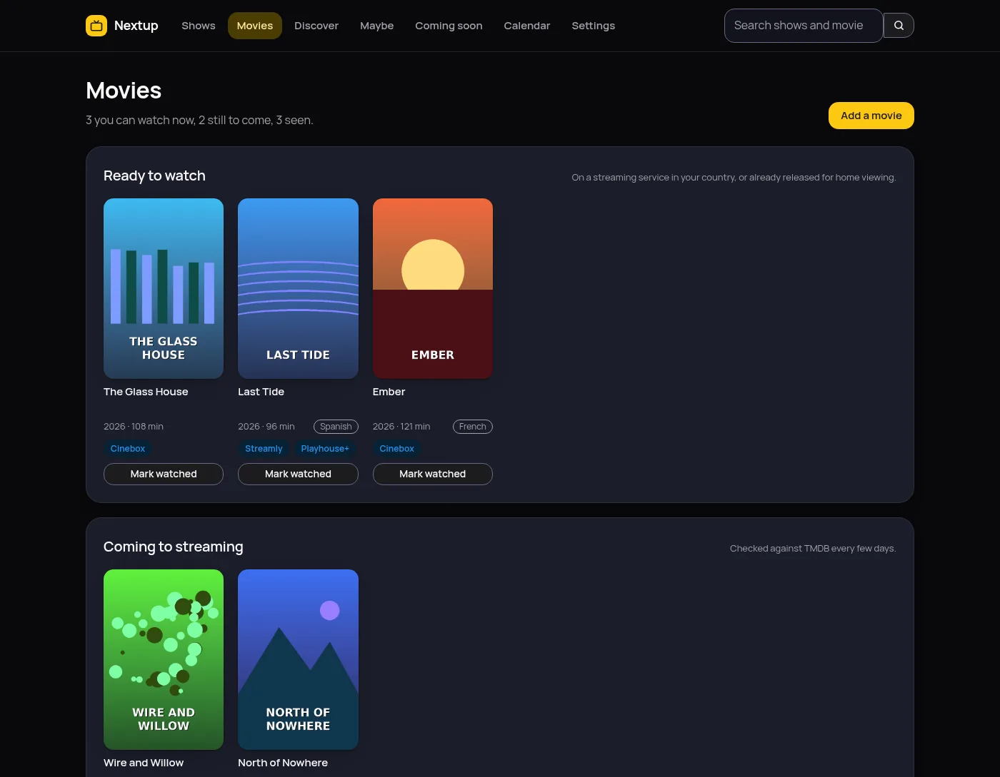

<p align="center">
  
</p>

<p align="center">
  
  
  
  
</p>

Nextup remembers where you are in every show you watch, works out what is
waiting for you, and tells you when a film reaches home viewing. It runs on
your own server, has one account and no signup, and never contacts us.

What you get for running it yourself: your watch history stays on your disk,
artwork is cached by your own server so no page ever points a browser at a
third party, and the only thing it ever calls out to is TMDB, to look up the
shows and films you asked for.

<p align="center">
  
</p>

## How it works

<p align="center">
  
</p>

## Quick start

```yaml
services:
  nextup:
    image: ghcr.io/gh-lm/nextup:latest
    container_name: nextup
    restart: unless-stopped
    ports:
      - "127.0.0.1:4090:8080"
    security_opt:
      - no-new-privileges:true
    cap_drop:
      - ALL
    read_only: true
    tmpfs:
      - /tmp
    volumes:
      - /opt/nextup:/data
      - /etc/localtime:/etc/localtime:ro
```

```bash
sudo mkdir -p /opt/nextup
sudo chown -R 1000:1000 /opt/nextup
docker compose up -d
```

Open <http://localhost:4090> and sign in with **admin** and **nextup**. Nextup
then makes you choose your own password before it shows anything else.

The container runs as user 1000, not root, so the `chown` above matters.
Without it Nextup cannot write to the directory you mounted, and it fails to
start with a permission error on `/data/session.key`.

Nextup needs a free TMDB API key before it can look anything up. Make an
account, go to <https://www.themoviedb.org/settings/api>, and copy the **API
Key (v3 auth)**. It goes into the Settings page inside the app, never into
this compose file: it is checked against TMDB and then stored encrypted.

To update:

```bash
docker compose pull
docker compose down
docker compose up -d
```

`docker compose up -d` on its own will not re-pull a cached `:latest`.

## Catching up without forty clicks

Pick the last episode you remember watching and press **Up to here**.
Everything before it is ticked in one go, which is how a show you started
three years ago comes back under control. Episodes that have not aired cannot
be ticked by accident, and the progress bar counts only what has actually been
broadcast.

<table>
<tr>
<td width="50%"></td>
<td width="50%"></td>
</tr>
<tr>
<td align="center"><b>Every season and episode, with the detail worth reading</b></td>
<td align="center"><b>The month at a glance</b></td>
</tr>
</table>

## One email, every morning

A short message listing what became watchable overnight: the cover of each
show and film, a couple of sentences about it, which service it is on, and a
link straight to it. If nothing became available, nothing is sent. The covers
travel inside the message, so it reads properly with no signal.

<table>
<tr>
<td width="50%"></td>
<td width="50%"></td>
</tr>
<tr>
<td align="center"><b>The morning email</b></td>
<td align="center"><b>Films, and when you can actually watch them</b></td>
</tr>
</table>

## What it does

- **Next up**: every show with an aired episode you have not watched, oldest
  first, with a one-click watched button
- **My shows**: a poster grid with a progress bar per show, and a filter for
  the ones you are behind on
- **Show pages**: every season and episode, ticked one at a time, a whole
  season at once, or up to here for catching up
- **Calendar**: a month at a glance, episodes in yellow and films reaching
  home viewing in blue, each labelled so colour is not the only signal
- **Coming soon**: the next 14 to 180 days as a plain list
- **Maybe**: shows you fancy the look of but are not following, kept out of
  Next up, the calendar and the email until you decide
- **Films**: split into ready to watch, coming to streaming, and seen, with
  the date each one reaches home viewing and which UK services carry it
- **Discover**: separate pages for films and television, with a tick, a
  question mark and a cross on every card
- **Episode pages**: the still, synopsis, air date, runtime, guest cast and
  director, with links either side
- **A morning email** at a time you choose, to the minute, with a 24 hour or
  am and pm clock
- **A watchable-after setting**, so something that airs at eleven at night
  does not count until you would really watch it
- **Backup and restore** from the Settings page, as one JSON file
- Posters cached by your own server, and the font served locally, so no page
  calls out to anyone

Tracked shows refresh every 12 hours by default; finished shows are checked
far less often. Film availability is re-checked every few days. Streaming
service listings come from JustWatch by way of TMDB.

## Settings

Everything that makes your copy yours is set in the app itself: your username
and password, the TMDB key, the mail server, the send time, the watchable-after
delay and the accent colour. Only the things that decide where the app lives
come from the environment.

| Variable | Required | Default | What it does |
|---|---|---|---|
| `NEXTUP_DATA_DIR` | no | `/data` | Where the database, the keys and the poster cache live |
| `NEXTUP_PORT` | no | `8080` | Port inside the container |
| `NEXTUP_HOST` | no | `0.0.0.0` | Address to bind inside the container |
| `NEXTUP_HTTPS_ONLY` | no | `0` | Set to `1` only when every way in really is HTTPS. It marks the login cookie Secure, so a browser will not send it over plain HTTP at all. Leave it off if you reach the container directly on `127.0.0.1:4090` |
| `TZ` | no | unset | Only needed for a different timezone from the machine itself. The compose file mounts `/etc/localtime` instead, so the container follows the server |

## Where your data lives

One directory, the one you mounted:

- `nextup.db`, the shows, the episodes and what you have watched
- `secret.key`, which encrypts the TMDB key and the mail password (0600)
- `session.key`, which signs the login cookie (0600)
- `images/`, the cached posters and stills

Backing up that directory backs up everything. The Settings page also has a
**Download a backup** button that writes one JSON file holding every show and
film you added, what you marked watched, what you dismissed and your settings.
Your TMDB key and mail password are left out by default, because they are
encrypted with a key that stays on that server; a second button includes them
as plain text, so keep that file somewhere safe. Every backup, with or
without those two, also holds your username and a hash of your password, so
treat the file as private either way.

## Security

Found a vulnerability? [SECURITY.md](./SECURITY.md) says how to report it.
What follows is what is already built in.

- Your password is never stored, only a hash of it.
- The TMDB key and the mail password are encrypted before they reach the
  database, with a key held beside it at 0600 and readable only by the user
  the app runs as.
- The login cookie is signed, HttpOnly and SameSite Lax, and marked Secure
  when `NEXTUP_HTTPS_ONLY` is on.
- The container runs as user 1000, never root, and the compose file above
  drops every Linux capability, forbids gaining new privileges, and runs with
  a read-only filesystem and a small writable `/tmp`.
- No analytics, no telemetry and no third-party script. The only outbound
  calls are to TMDB and to your own mail server.

What it does not do: there is one account and no two-factor, there is no limit
on how many passwords can be tried, and there is no audit log. Keep it on your
own network or a tailnet rather than open to the internet.

## Building it yourself

```bash
git clone https://github.com/gh-lm/nextup.git
cd nextup
docker build -t nextup .
```

The published image is built by
[the workflow in this repository](.github/workflows/release.yml) when a version
tag is pushed, and lands at `ghcr.io/gh-lm/nextup`.

```bash
pip install -r requirements-dev.txt
pytest -q
```

### What is in the repository

```
nextup/
├── app/                      # Python and Flask
│   ├── routes/               # Pages: dashboard, shows, films, discover, settings
│   ├── templates/            # Jinja templates
│   ├── static/               # Plain CSS and a little JavaScript, no build step
│   ├── auth.py               # password hashing and the login check
│   ├── config.py             # the handful of environment variables
│   ├── db.py                 # SQLite, schema and migrations
│   ├── mailer.py             # the morning email
│   ├── posters.py            # fetches and caches artwork
│   ├── secretstore.py        # encrypts the TMDB key and mail password
│   ├── sync.py               # the background refresh
│   ├── tmdb.py               # the TMDB client
│   └── transfer.py           # backup and restore
├── docs/                     # The nextup.lightmorphic.com website
│   └── images/sources/       # The HTML that draws the banner and the diagram
├── tests/                    # the test suite
├── tools/stamp-assets.py     # Stamps the website's stylesheet with its hash
├── .github/workflows/        # Builds and publishes the image
├── Dockerfile
├── docker-compose.yml
├── CHANGELOG.md
├── CONTRIBUTING.md
├── SECURITY.md
└── LICENSE
```

## Licence

Copyright (C) 2026 Lightmorphic Ltd.

Nextup is free software: you can redistribute it and modify it under the terms
of the GNU General Public License version 3, as published by the Free Software
Foundation.

It is distributed in the hope that it will be useful, but WITHOUT ANY
WARRANTY, without even the implied warranty of MERCHANTABILITY or FITNESS FOR
A PARTICULAR PURPOSE. See [LICENSE](./LICENSE) for the full text, or
<https://www.gnu.org/licenses/>.

Every released version of Nextup has been under GPL v3.
[CHANGELOG.md](./CHANGELOG.md) has the version history.

This product uses the TMDB API but is not endorsed or certified by TMDB.

## Disclaimer

This software is provided "as is", without warranty of any kind, express or
implied. See the LICENSE file for the exact legal terms. You use it entirely
at your own risk.
